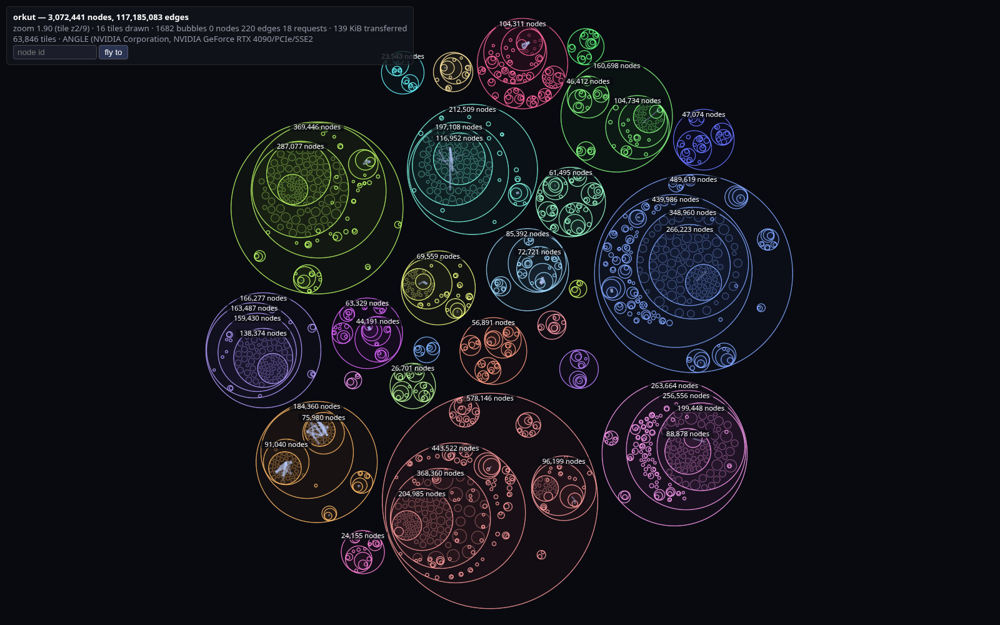

<h1>
  <picture>
    <source media="(prefers-color-scheme: dark)" srcset="design/system/mark/nest-dark.svg">
    
  </picture>
  Everygraph
</h1>

**Every graph, every size, every machine.** One engine to ingest, analyze, query and map
graphs on a single computer, inside the memory budget you set.

[](https://github.com/VincenzoImp/everygraph/actions/workflows/ci.yml?query=branch%3Amain)
[](#licence)
[](CONTRIBUTING.md#rust-version)
[](#what-works-today)

> **Status: early development.** Nothing is released, and no package is published yet.
> What works today builds from source.

Graph work today means a choice: tools that are comfortable but do not scale, or tools
that scale but are not comfortable. Then several of them are chained to prepare, analyze,
query and look at one graph. Everygraph is one embeddable engine for all four, from
thousands of edges to billions: a Rust core and one open file format, with a command
line, Python and a map viewer on top.

## Three promises

1. **Open anything fast.** A file of edges becomes a graph you can analyze. Before
   anything long runs, the engine says what it read, what it will do and what that costs.
2. **Never run out of memory.** You set a memory budget. The engine plans first and stays
   inside it, or says exactly why it cannot.
3. **See it and trust it.** A zoomable map of the whole graph, with exact numbers at every
   level. The same input gives the same result at any number of threads, and the map is
   one static file you can share.

[docs/DESIGN.md § 2](docs/DESIGN.md#2-the-product) says how each promise is measured.

## What works today

- **Crates:** the `.eg` graph file with compressed adjacency and property columns; the
  text reader and the graph build under a memory budget; the edge-map framework with
  PageRank, BFS, SSSP, weak and strong components, core numbers and degrees, and the
  planner that chooses how each runs; Leiden communities and the map tree, as a library;
  point queries and filtered views; the `.egmap` map file format.
  [CONTRIBUTING.md, "Crates"](CONTRIBUTING.md#crates) says what each crate owns.
- **Command line:** `everygraph ingest`, `run` (pagerank, components, kcore, degrees,
  bfs), `info`, `export`, `verify` and `compact`.
- **Python:** `eg.read`, `eg.open`, and PageRank, components, core numbers, degrees and
  BFS on a graph, with results as Arrow tables. It is built from source.

Measured results of these development builds, on one machine, are in
[bench/results/](bench/results/README.md).

## What is not solved yet

- **No map yet.** The layout, the tiles and the viewer are not built. The picture below
  is from the lab prototype.
- **Beyond RAM:** community detection works out of core in the lab for one graph, not
  yet in the product (#60). The streaming source for kernels on a graph larger than the
  budget is not finished (#46), and no official run of the product covers that case.
- **Speed:** the product's graph build and several kernels are slower than the lab
  prototypes and the best tools; the gaps are listed in the performance pass (#240).
- **The headline, "1.8 B edges to a map on a 16 GB laptop", has not been run end to end.**

Each open problem and the issue that owns it are in
[docs/DESIGN.md § 5](docs/DESIGN.md#5-what-is-not-solved-yet).



<sub>com-Orkut (3,072,441 nodes, 117,185,083 edges) in the lab prototype's viewer
(`lab/e-map`). Each circle is a community. This is research code, not the product's map.</sub>

## Quickstart

You need Rust 1.100 or newer. This builds the command line, ingests a small public graph
(SNAP's ego-Facebook, 4,039 nodes and 88,234 edges) and runs PageRank:

```sh
git clone https://github.com/VincenzoImp/everygraph
cd everygraph
cargo build --release -p everygraph-cli
curl -LO https://snap.stanford.edu/data/facebook_combined.txt.gz
target/release/everygraph ingest facebook_combined.txt.gz
target/release/everygraph run pagerank facebook_combined.eg --top 5
target/release/everygraph info facebook_combined.eg
```

`ingest` writes `facebook_combined.eg` beside the input. `run … --out pagerank.parquet`
writes the whole result. The next step that `ingest` suggests, `everygraph map`, is not
built yet.

Python 3.10 or newer, from the same checkout (with [uv](https://docs.astral.sh/uv/)):

```sh
uv venv && uv pip install maturin
uv run maturin develop --release -m crates/everygraph-py/Cargo.toml
uv run python -c 'import everygraph as eg; print(eg.read("facebook_combined.txt.gz").pagerank().top(5))'
```

## Where to look

- [docs/DESIGN.md](docs/DESIGN.md): the product, the architecture and the decisions,
  each with its evidence and its record under [docs/adr/](docs/adr/README.md).
- [docs/api-sketch.md](docs/api-sketch.md): the Python, Rust and command-line surface.
  [design/](design/DECISIONS.md): what a user sees, as approved.
- [docs/spec/](docs/spec/): the file formats and the graph semantics.
- [docs/FINDINGS.md](docs/FINDINGS.md): what the lab measured, negative results included.
- [docs/ROADMAP.md](docs/ROADMAP.md): the milestones and the critical path.
  [docs/STATE.md](docs/STATE.md): where the work is now.
- [bench/](bench/README.md), [oracle/](oracle/README.md), [datasets/](datasets/README.md)
  and [lab/](lab/README.md): benchmarks, the correctness oracle, the dataset registry and
  the research prototypes.

## Contributing

Issues and pull requests are welcome. [CONTRIBUTING.md](CONTRIBUTING.md) has the checks
and the coding rules. Every commit needs a `Signed-off-by` line (Developer Certificate of
Origin); there is no contributor licence agreement. The project is developed by AI agents
for one maintainer: [GOVERNANCE.md](GOVERNANCE.md) says who decides and who answers for
the work. Conduct follows the [code of conduct](CODE_OF_CONDUCT.md). Report a
vulnerability privately, as [SECURITY.md](SECURITY.md) says.

## Licence

Code is dual-licensed under [Apache-2.0](LICENSE-APACHE) or [MIT](LICENSE-MIT), at your
option. Documentation and format specifications are under [CC BY 4.0](LICENSE-DOCS),
which lists the exact paths. Third-party files keep their own licences
([THIRD-PARTY-NOTICES.md](THIRD-PARTY-NOTICES.md)). The format specifications are public
and versioned, and no feature will be held back for a paid edition.

**No telemetry.** Everygraph sends nothing anywhere unless you ask it to.
