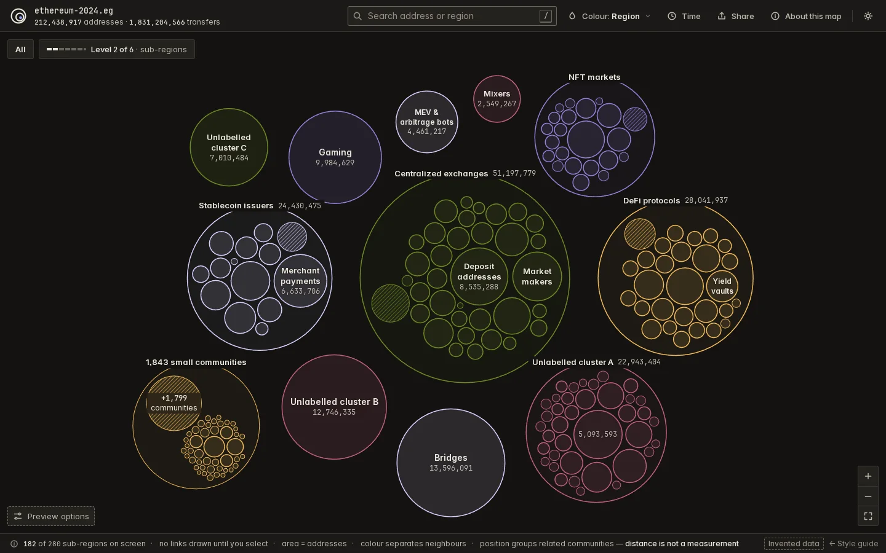
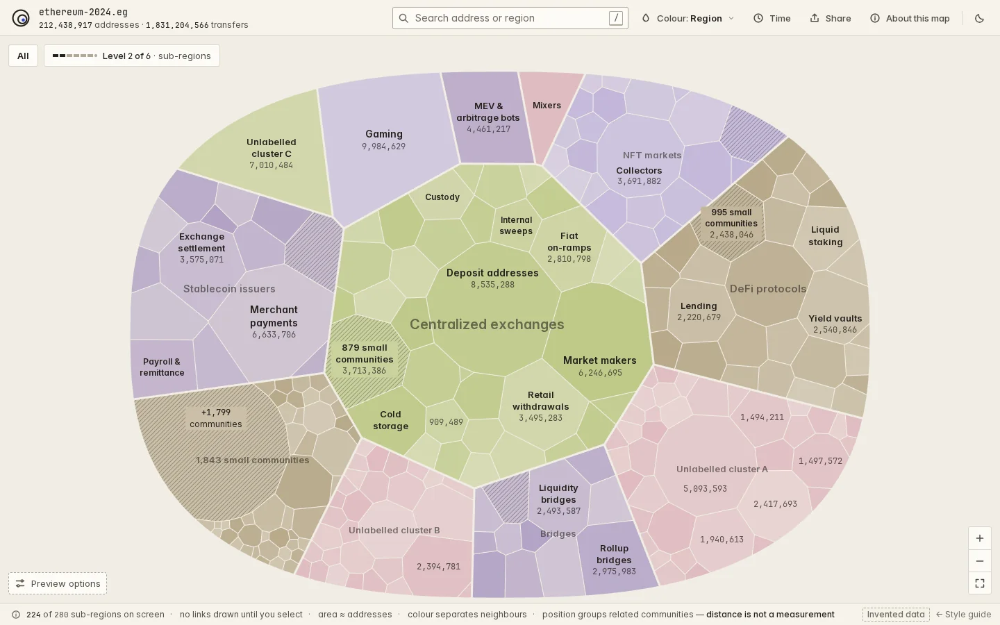
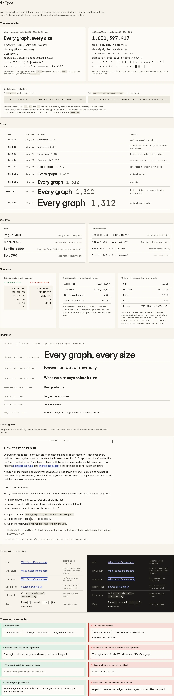
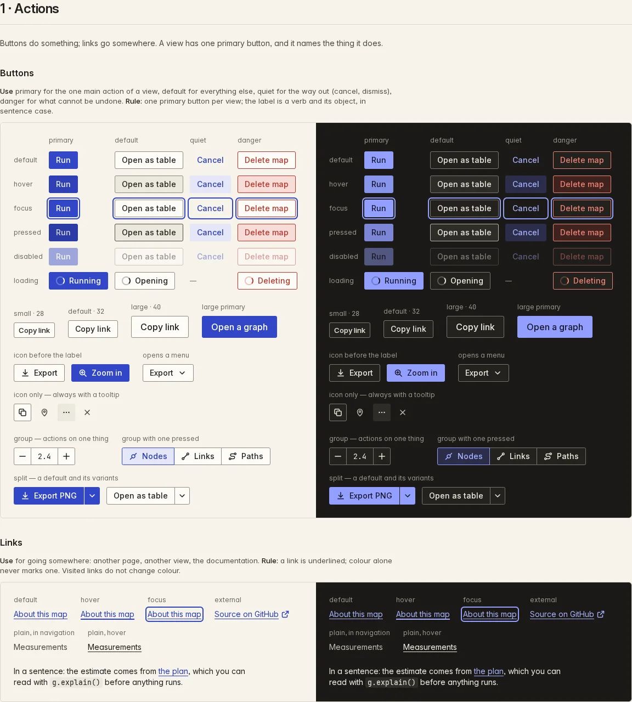
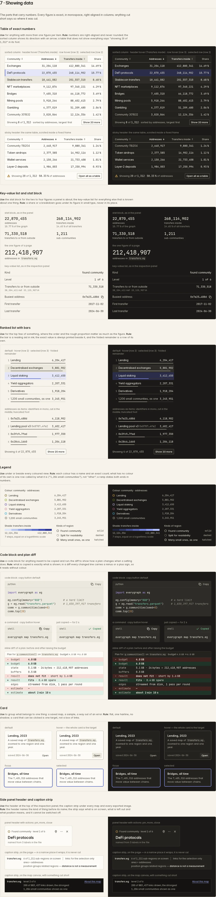
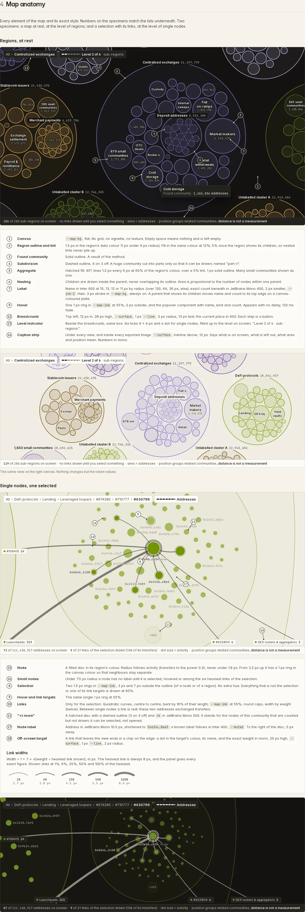
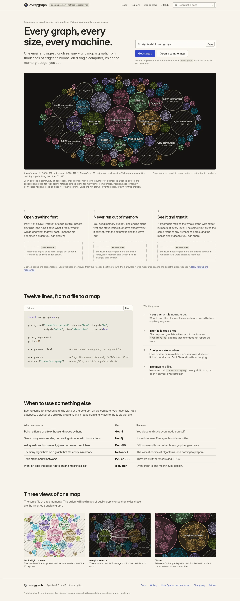
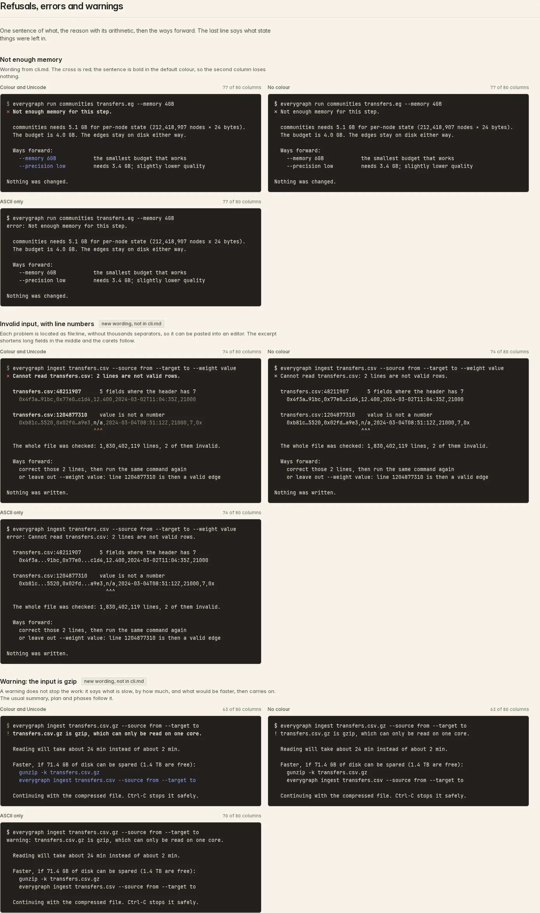
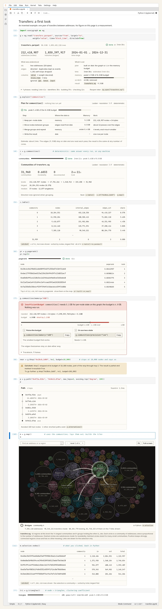

# The Everygraph style, in detail

One style, shown everywhere it will be used. Working name **Vernier**: a calm measuring
instrument — warm paper, soft black, one ink-blue accent, every number in monospace,
hairlines instead of boxes, almost no shadow.

Everything below is a preview with invented data. The rules are in [`SPEC.md`](SPEC.md),
the values in [`design/system/tokens.css`](../../system/tokens.css). Ten HTML pages show them live
(`index.html` is the entry); this page shows the same content as images so it can be read
on GitHub. To browse the pages themselves, clone the repository and open
`design/preview/style/index.html`.

**Contents** · [At a glance](#at-a-glance) · [The viewer](#the-viewer) ·
[Foundations](#foundations) · [Components](#components) · [Data and map](#data-and-map) ·
[Web and docs](#web-and-docs) · [Terminal](#terminal) · [Notebook](#notebook) ·
[Figures and export](#figures-and-export) · [Decisions and open strains](#decisions-and-open-strains)

---

## At a glance

[The same page in the dark theme](https://github.com/VincenzoImp/everygraph/blob/design-previews-archive/design/preview/screens/g-full-index-dark.webp?raw=true)

## The viewer

The product's main screen, fully in the style ([`viewer.html`](viewer.html), navigable).

| The whole graph | A region selected |
|---|---|
|  |  |

| One address and its links | A path between two addresses |
|---|---|
|  |  |

| Light theme | "Cells" style, light |
|---|---|
|  |  |

More states: [first open](https://github.com/VincenzoImp/everygraph/blob/design-previews-archive/design/preview/screens/s-21-viewer-01-first-open.webp?raw=true) ·
[plan before starting](https://github.com/VincenzoImp/everygraph/blob/design-previews-archive/design/preview/screens/s-21-viewer-02-preflight.webp?raw=true) ·
[progress](https://github.com/VincenzoImp/everygraph/blob/design-previews-archive/design/preview/screens/s-21-viewer-03-progress.webp?raw=true) ·
[cells, dark](https://github.com/VincenzoImp/everygraph/blob/design-previews-archive/design/preview/screens/s-21-viewer-06-cells-dark.webp?raw=true) ·
[search](https://github.com/VincenzoImp/everygraph/blob/design-previews-archive/design/preview/screens/s-21-viewer-10-search.webp?raw=true) ·
[path avoiding hubs](https://github.com/VincenzoImp/everygraph/blob/design-previews-archive/design/preview/screens/s-21-viewer-12-path-avoiding-hubs.webp?raw=true) ·
[time window](https://github.com/VincenzoImp/everygraph/blob/design-previews-archive/design/preview/screens/s-21-viewer-13-time-window.webp?raw=true) ·
[colour by attribute](https://github.com/VincenzoImp/everygraph/blob/design-previews-archive/design/preview/screens/s-21-viewer-14-colour-by-attribute.webp?raw=true) ·
[colour by metric](https://github.com/VincenzoImp/everygraph/blob/design-previews-archive/design/preview/screens/s-21-viewer-15-colour-by-metric.webp?raw=true) ·
[share](https://github.com/VincenzoImp/everygraph/blob/design-previews-archive/design/preview/screens/s-21-viewer-16-share-dialog.webp?raw=true) ·
[about this map](https://github.com/VincenzoImp/everygraph/blob/design-previews-archive/design/preview/screens/s-21-viewer-17-about-this-map.webp?raw=true) ·
[compact](https://github.com/VincenzoImp/everygraph/blob/design-previews-archive/design/preview/screens/s-21-viewer-18-compact.webp?raw=true) ·
[narrow window](https://github.com/VincenzoImp/everygraph/blob/design-previews-archive/design/preview/screens/s-21-viewer-19-narrow-1024x700.webp?raw=true) ·
[one colour per region](https://github.com/VincenzoImp/everygraph/blob/design-previews-archive/design/preview/screens/s-21-viewer-20-region-colours-one-per-region.webp?raw=true)

## Foundations

**The mark** — construction, sizes, the small cut, what never to do.

**Colour** — every value with its measured contrast.

**Type**

Also: [wordmark and lockups](https://github.com/VincenzoImp/everygraph/blob/design-previews-archive/design/preview/screens/g-foundations-02-wordmark.webp?raw=true) ·
[space and layout](https://github.com/VincenzoImp/everygraph/blob/design-previews-archive/design/preview/screens/g-foundations-05-space.webp?raw=true) ·
[shape, borders, elevation](https://github.com/VincenzoImp/everygraph/blob/design-previews-archive/design/preview/screens/g-foundations-06-shape.webp?raw=true) ·
[motion](https://github.com/VincenzoImp/everygraph/blob/design-previews-archive/design/preview/screens/g-foundations-07-motion.webp?raw=true) ·
[icons](https://github.com/VincenzoImp/everygraph/blob/design-previews-archive/design/preview/screens/g-foundations-08-icons.webp?raw=true) ·
[accessibility summary](https://github.com/VincenzoImp/everygraph/blob/design-previews-archive/design/preview/screens/g-foundations-09-a11y.webp?raw=true)

## Components

Every component in all its states, light and dark side by side.

**A whole panel assembled from the components**

Also: [inputs](https://github.com/VincenzoImp/everygraph/blob/design-previews-archive/design/preview/screens/g-components-02-inputs.webp?raw=true) ·
[tags, keys, tooltips](https://github.com/VincenzoImp/everygraph/blob/design-previews-archive/design/preview/screens/g-components-03-small.webp?raw=true) ·
[menus, dialogs, toasts](https://github.com/VincenzoImp/everygraph/blob/design-previews-archive/design/preview/screens/g-components-04-overlays.webp?raw=true) ·
[progress, loading, empty states](https://github.com/VincenzoImp/everygraph/blob/design-previews-archive/design/preview/screens/g-components-05-waiting.webp?raw=true) ·
[pagination, breadcrumb, disclosure](https://github.com/VincenzoImp/everygraph/blob/design-previews-archive/design/preview/screens/g-components-06-nav.webp?raw=true)

## Data and map

**The palette, measured** (including for colour-blind readers)

**How regions are coloured** — the one open question with real consequences

**Anatomy of the map**

**Connections** — how the regions connect with nothing selected, on real lj and orkut
counts ([`overview.html`](overview.html); `design/DECISIONS.md`, "Connections with nothing
selected"). It has no screenshot; open the page.

Also (light · dark): scales [l](https://github.com/VincenzoImp/everygraph/blob/design-previews-archive/design/preview/screens/g-data-03-s3.webp?raw=true) · [d](https://github.com/VincenzoImp/everygraph/blob/design-previews-archive/design/preview/screens/g-data-03-s3-dark.webp?raw=true) ·
zoom levels [l](https://github.com/VincenzoImp/everygraph/blob/design-previews-archive/design/preview/screens/g-data-05-s5.webp?raw=true) · [d](https://github.com/VincenzoImp/everygraph/blob/design-previews-archive/design/preview/screens/g-data-05-s5-dark.webp?raw=true) ·
states of the map [l](https://github.com/VincenzoImp/everygraph/blob/design-previews-archive/design/preview/screens/g-data-06-s6.webp?raw=true) · [d](https://github.com/VincenzoImp/everygraph/blob/design-previews-archive/design/preview/screens/g-data-06-s6-dark.webp?raw=true) ·
labels [l](https://github.com/VincenzoImp/everygraph/blob/design-previews-archive/design/preview/screens/g-data-07-s7.webp?raw=true) · [d](https://github.com/VincenzoImp/everygraph/blob/design-previews-archive/design/preview/screens/g-data-07-s7-dark.webp?raw=true) ·
small charts [l](https://github.com/VincenzoImp/everygraph/blob/design-previews-archive/design/preview/screens/g-data-08-s8.webp?raw=true) · [d](https://github.com/VincenzoImp/everygraph/blob/design-previews-archive/design/preview/screens/g-data-08-s8-dark.webp?raw=true) ·
result tables [l](https://github.com/VincenzoImp/everygraph/blob/design-previews-archive/design/preview/screens/g-data-09-s9.webp?raw=true) · [d](https://github.com/VincenzoImp/everygraph/blob/design-previews-archive/design/preview/screens/g-data-09-s9-dark.webp?raw=true) ·
palette, dark [d](https://github.com/VincenzoImp/everygraph/blob/design-previews-archive/design/preview/screens/g-data-01-s1-dark.webp?raw=true) · anatomy, dark [d](https://github.com/VincenzoImp/everygraph/blob/design-previews-archive/design/preview/screens/g-data-04-s4-dark.webp?raw=true)

## Web and docs

**Landing page**

[Dark](https://github.com/VincenzoImp/everygraph/blob/design-previews-archive/design/preview/screens/g-full-landing-dark.webp?raw=true) ·
[on a phone](https://github.com/VincenzoImp/everygraph/blob/design-previews-archive/design/preview/screens/s-30-web-03b-landing-mobile-sheet.webp?raw=true) ·
[documentation page](https://github.com/VincenzoImp/everygraph/blob/design-previews-archive/design/preview/screens/g-full-docs-light.webp?raw=true)

The guide's sections for the web, in order:
[1](https://github.com/VincenzoImp/everygraph/blob/design-previews-archive/design/preview/screens/g-web-01-section.webp?raw=true) · [2](https://github.com/VincenzoImp/everygraph/blob/design-previews-archive/design/preview/screens/g-web-02-section.webp?raw=true) ·
[3](https://github.com/VincenzoImp/everygraph/blob/design-previews-archive/design/preview/screens/g-web-03-section.webp?raw=true) · [4](https://github.com/VincenzoImp/everygraph/blob/design-previews-archive/design/preview/screens/g-web-04-section.webp?raw=true) ·
[5](https://github.com/VincenzoImp/everygraph/blob/design-previews-archive/design/preview/screens/g-web-05-section.webp?raw=true) · [6](https://github.com/VincenzoImp/everygraph/blob/design-previews-archive/design/preview/screens/g-web-06-section.webp?raw=true) ·
[7](https://github.com/VincenzoImp/everygraph/blob/design-previews-archive/design/preview/screens/g-web-07-section.webp?raw=true) · [8](https://github.com/VincenzoImp/everygraph/blob/design-previews-archive/design/preview/screens/g-web-08-section.webp?raw=true)
(landing, documentation, API reference, search, 404, changelog, README header, social card and slide)

## Terminal

**One transcript three ways**: colour, no colour, ASCII only.

**When it refuses, errs or warns**

Also: [colours](https://github.com/VincenzoImp/everygraph/blob/design-previews-archive/design/preview/screens/g-terminal-02-colour.webp?raw=true) ·
[symbols and fallbacks](https://github.com/VincenzoImp/everygraph/blob/design-previews-archive/design/preview/screens/g-terminal-03-symbols.webp?raw=true) ·
[progress and alignment](https://github.com/VincenzoImp/everygraph/blob/design-previews-archive/design/preview/screens/g-terminal-04-anatomy.webp?raw=true) ·
[help](https://github.com/VincenzoImp/everygraph/blob/design-previews-archive/design/preview/screens/g-terminal-05-help.webp?raw=true) ·
[from a file to a map](https://github.com/VincenzoImp/everygraph/blob/design-previews-archive/design/preview/screens/g-terminal-06-file-to-map.webp?raw=true) ·
[questions, info, doctor](https://github.com/VincenzoImp/everygraph/blob/design-previews-archive/design/preview/screens/g-terminal-07-questions.webp?raw=true) ·
[interrupt and resume](https://github.com/VincenzoImp/everygraph/blob/design-previews-archive/design/preview/screens/g-terminal-09-interrupt.webp?raw=true) ·
[for scripts](https://github.com/VincenzoImp/everygraph/blob/design-previews-archive/design/preview/screens/g-terminal-10-scripts.webp?raw=true) ·
[on other terminals](https://github.com/VincenzoImp/everygraph/blob/design-previews-archive/design/preview/screens/g-terminal-11-light.webp?raw=true)

## Notebook

[Dark](https://github.com/VincenzoImp/everygraph/blob/design-previews-archive/design/preview/screens/g-full-notebook-dark.webp?raw=true) ·
[states](https://github.com/VincenzoImp/everygraph/blob/design-previews-archive/design/preview/screens/g-notebook-04-states.webp?raw=true) ·
[the same objects as plain text](https://github.com/VincenzoImp/everygraph/blob/design-previews-archive/design/preview/screens/g-notebook-05-text.webp?raw=true)

## Figures and export

**A map as a figure for a paper** — black, white and data colours only, caption included.

Also: [charts](https://github.com/VincenzoImp/everygraph/blob/design-previews-archive/design/preview/screens/g-export-02-charts.webp?raw=true) ·
[the page a recipient sees](https://github.com/VincenzoImp/everygraph/blob/design-previews-archive/design/preview/screens/g-export-03-shared.webp?raw=true) ·
[embedded in an article](https://github.com/VincenzoImp/everygraph/blob/design-previews-archive/design/preview/screens/g-export-04-embed.webp?raw=true) ·
[how to cite](https://github.com/VincenzoImp/everygraph/blob/design-previews-archive/design/preview/screens/g-export-05-cite.webp?raw=true) ·
[file icons](https://github.com/VincenzoImp/everygraph/blob/design-previews-archive/design/preview/screens/g-export-06-files.webp?raw=true) ·
[message preview](https://github.com/VincenzoImp/everygraph/blob/design-previews-archive/design/preview/screens/g-export-07-message.webp?raw=true)

---

## Decisions and open strains

The owner approved this style on 2026-11-25 (`design/DECISIONS.md`, "Visual identity,
round 2").

**Decided while building this** (details in `SPEC.md`, last section):

- The first data palette I picked by eye failed measurement and was replaced by a measured one.
- Contrast of text and control borders was adjusted until it passed; borders are a little heavier for it.
- Regions on the map use five colours, reused where regions do not touch.
- Numbers in monospace, units and column headers in the text face; no ligatures in code.
- In the terminal, the suggested next command is bold rather than blue; lines fit 80 columns.
- "Budget" means memory only; traversal limits are called `limit`.

**Where the style strains:**

- When most nodes live in small communities, the grey hatched "many small communities"
  regions are the largest shapes on the map. Honest, but it is the first thing the eye sees.
- With the accent reserved for interactive things, the landing page is quiet: one blue button.
- The icon set is a first pass; about six icons need redrawing.
- A single-column figure (85 mm) is too small for names; it uses letter keys and a legend.

**Questions asked at review**, each answered with ★ (`design/DECISIONS.md`, "All
remaining preview choices", style questions 1–7):

1. **The whole direction.** Approved as shown ("va benissimo il lavoro fatto").
2. **Viewer by default:** dark canvas ★, or light.
3. **Map style:** bubbles ★, or cells (see the two "light theme" images above).
4. **Landing headline:** all in ink ★ (as shown), or the last words in the accent blue.
5. **Hatched "small communities" regions:** as drawn ★, or lighter so they recede.
6. **The mark at small sizes:** the heavier small cut ★, or always the full mark.
7. **A tagline under the wordmark?** None ★, or "Every graph, every size, every machine."
